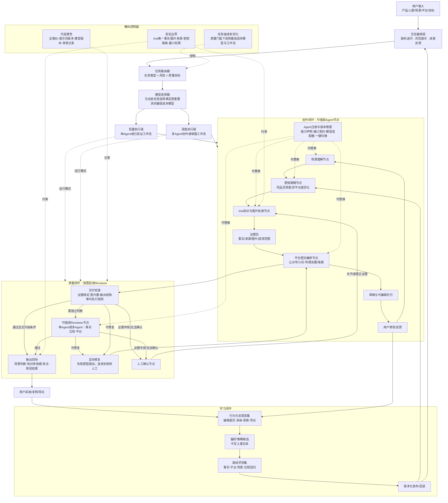

# AI+华为PC营销软文智能体：最终架构

## 一、总架构图

## 二、三个闭环

| 闭环 | 必须解决的问题 | 核心机制 |
|---|---|---|
| 创作闭环 | 同一产品换场景、换平台后仍然有效 | 先场景判断，再定营销策略，再取证，最后按平台编排；用户修改后可继续迭代 |
| 质量闭环 | 不能把模型“说得像真的”当成事实 | ima 是产品事实和图片唯一来源；事实、合规、平台分别检查。质量节点可配置为单 Agent 或多 Agent；上下文完整且结果达到门槛时一次通过，只有不确定或高风险结果才升级独立 Review；冲突即停，不猜测 |
| 学习闭环 | 越用越好，但不能被错误反馈污染 | 学习用户偏好和策略，不直接改事实；候选策略须经固定评测集回归后版本化发布，可回滚 |

## 三个横向因素

- **成本**：系统不设固定调用上限作为目标，而是先定义当前任务的最低质量门槛，再从可用模型和工作流中选择预计成本最低的方案。写稿任务若强模型一次满足全部约束，就直接一次交付；只有质量门槛无法满足、证据风险较高或结果不确定时，才升级 Reviewer、多 Agent 或重试。
- **可插拔性**：每个核心节点都通过统一输入输出契约、能力声明和模型适配器解耦。节点实现、模型版本和 Agent 提供方可以独立替换；注册、评测、灰度和回滚后即可一键切换。
- **人机交互与可追溯性**：人在需求方向不清、证据冲突和多个合格稿件取舍时介入。每个事实、图片、判断和修改都绑定来源 ID、时间、版本、Agent、模型、提示词和审查结果；界面显示进度、证据来源和风险原因。

## 四、节点替换与执行策略

- **完整上下文**：执行前组装当前任务需要的用户目标、场景、平台规则、营销要求、事实与图片证据、禁止事项和输出格式；处理证据缺失与约束冲突后再生成。完整注入是必要条件，不保证模型绝不出错。
- **选择依据**：用代表性任务评测模型与 Agent 组合的一次通过率、事实错误率、时延和每个合格结果的总成本（含上下文、检索、Review 和返工）。在质量达标的组合中选成本最低者，不能只比较模型单价或相信模型自评分。
- **统一契约**：节点输入为任务、约束、证据和工作流版本；输出为结果、引用、校验记录和状态（通过／缺证／冲突／失败）。业务状态与证据保存在系统侧，不依赖某个 Agent 的私有记忆。
- **两层替换**：模型适配器负责更换模型；Agent 适配器负责接入自研或第三方实现。每个节点都可绑定一个单 Agent 实现或一个多 Agent 子工作流，内部结构不影响上下游契约。
- **一键切换**：通过配置切换已接入且评测合格的实现；第三方 Agent 首次接入需适配接口、核对工具权限与数据访问范围。每次任务锁定配置版本，新版本可灰度、回滚；不能承诺任意外部 Agent 无适配即用。
- **架构实验**：同一节点的单 Agent 与多 Agent 方案使用相同输入、约束和评测集对照，按质量、成本与时延选择。Reviewer 是可选能力；价格、型号等风险触发是否升级由评测确定，已验证可靠的方案不强制追加 Review。

## 五、赛题硬约束落点

- **事实与图片**：只能来自指定 ima 知识库；无法确认不生成；冲突转人工。
- **平台**：公众号 2–4 图、小红书 3–6 图、朋友圈 1–3 图、海报 1 主视觉且最多 3 卖点；结构、语气和 CTA 随平台改变。
- **交付**：输出场景判断、知识库依据、图文软文、核验结果四块，并支持临时修改、复制、导出。
- **自研 Agent**：自研的是业务编排、策略、提示词、证据约束、审查和学习机制；基础模型可调用公开模型。
- **演示重点**：至少展示两种场景、两种平台，以及“正常通过”和“证据不足/冲突而停止”的对照结果。
